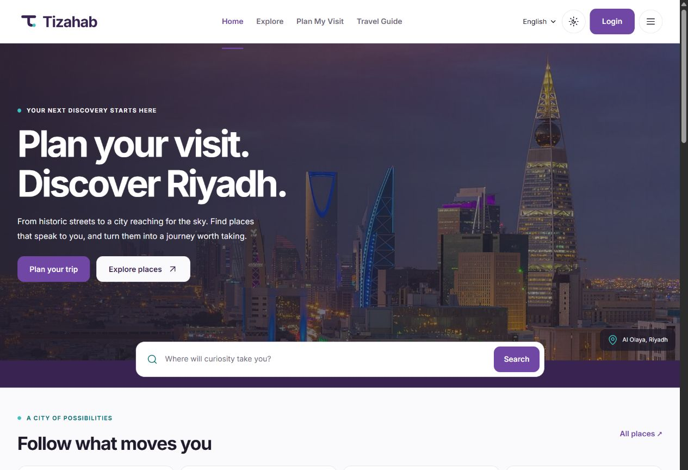
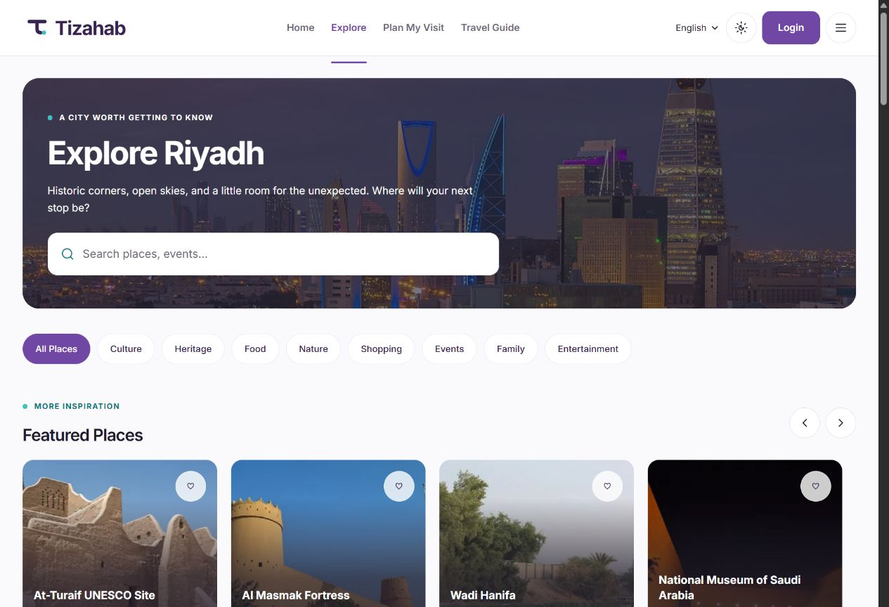
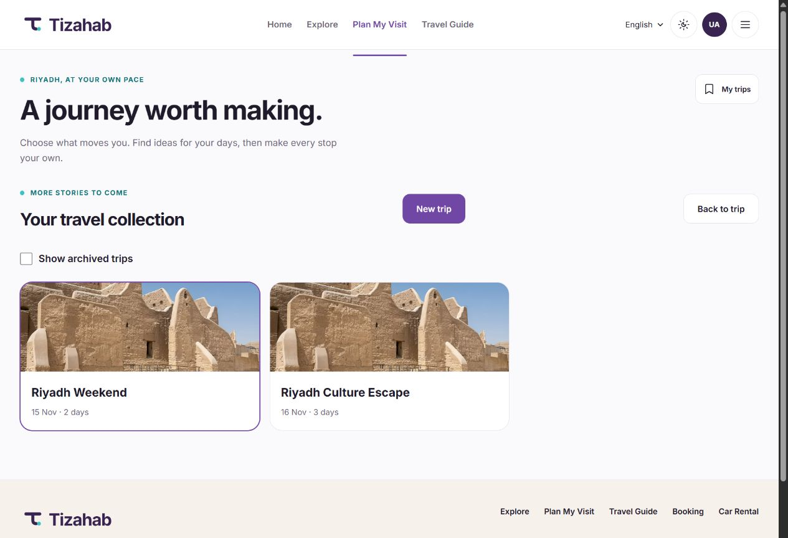
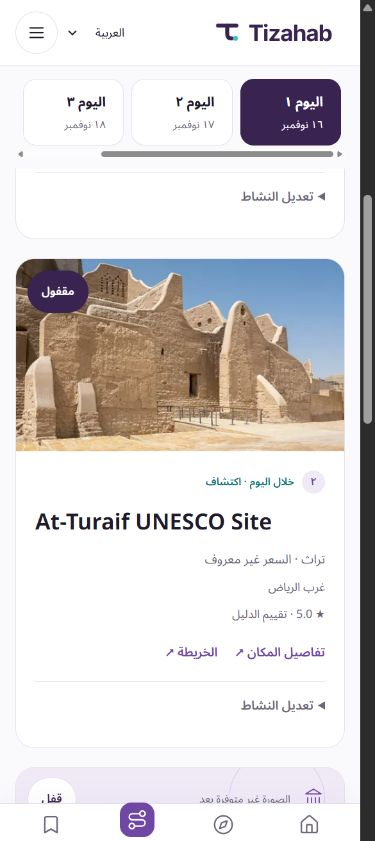
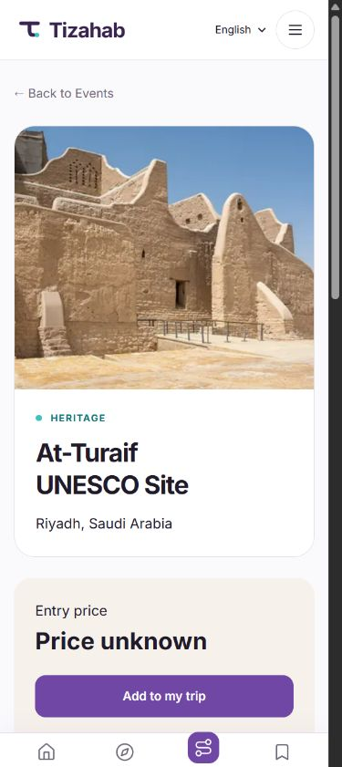

# Tizahab — Discover Riyadh, Plan It Your Way

## About Tizahab

Tizahab helps local and international visitors discover Riyadh and create
personalized itineraries. Find places that match your interests, shape each day
of your visit, and keep your plans ready for your next adventure.

## How It Works

| 1 · Make it yours | 2 · Find your next stop | 3 · Shape your journey |
|---|---|---|
| Choose your dates and interests. | Explore destinations and generate a trip. | Customize, save, and revisit your itinerary. |

## Features

- **Personalized trip planning** — suggestions based on your interests and trip preferences.
- **Guest trip previews** — start planning without an account; sign in when you want to save.
- **Destination discovery** — search Riyadh's places, browse categories, and open location links.
- **Daily and multi-day itineraries** — organize a day out or a longer visit.
- **Activity customization** — add, move, replace, or lock places and regenerate your plans.
- **Saved trips** — name your trips, return to them, and keep several journeys of your own.
- **Arabic and English** — a mobile-first experience with RTL and LTR layouts.

## Project Gallery

Real views from the application, using sample itineraries.

| Explore Riyadh | Your saved trips |
|---|---|
|  |  |

| Trip Planner · Arabic | Destination Details · English |
|:---:|:---:|
|  |  |

## Links

- [Tizahab V2 on GitHub](https://github.com/MajdAlharbi/tizahab-v2)
- [Run Tizahab locally](docs/README.md)
- [API reference](docs/API_DOCUMENTATION.md) · [Deployment guide](docs/DEPLOYMENT.md)

## Credits

Tizahab began as a university graduation project built by the
[original Tizahab team](https://github.com/MajdAlharbi/tizahab-web). V2 is an
independently directed continuation by [Majd Alharbi](https://github.com/MajdAlharbi),
building on the original team's shared implementation.

Riyadh skyline: [B.alotaby](https://commons.wikimedia.org/wiki/File:Riyadh_Skyline.jpg),
[CC BY-SA 4.0](https://creativecommons.org/licenses/by-sa/4.0/). Destination photos:
[sources and licenses](static/images/places/credits.json). Images are resized and
cropped for display; the photographs retain their listed licenses, including
when shown in the application screenshots.
